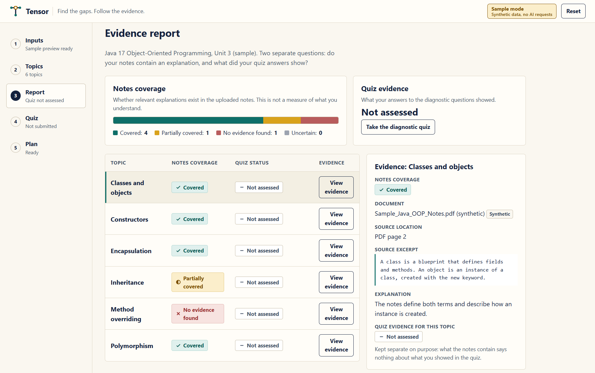
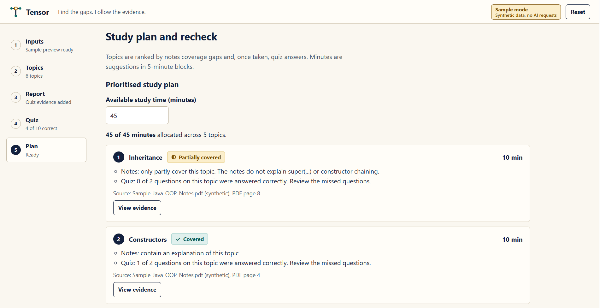
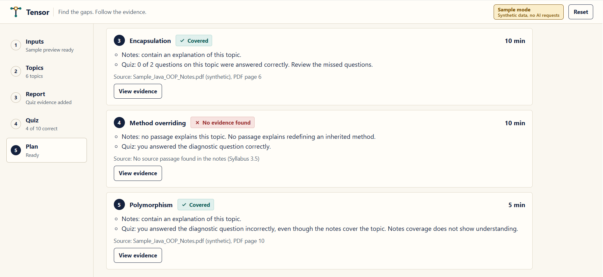
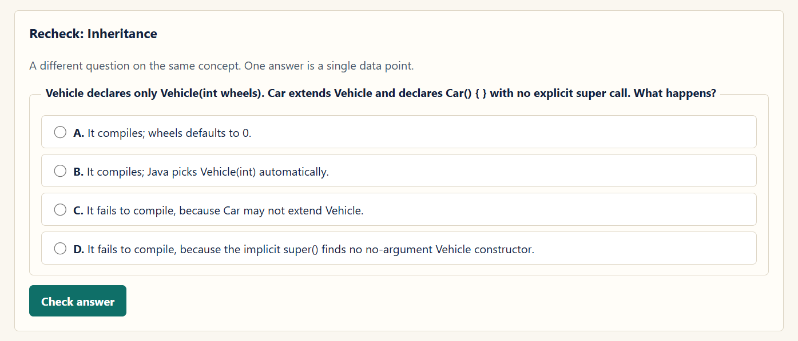

# Tensor

### Find the gaps. Follow the evidence.

**An evidence-based study preparation assistant built by Team Divergent for the NYLP AI Hackathon.**

Tensor compares a student's syllabus, study notes and diagnostic quiz answers to identify preparation gaps and recommend what to study next within the available time.

**[Open Live Demo](https://tensor-ool7.onrender.com/)**

For a quick walkthrough, choose **Open sample demo (no AI)**. Sample results are synthetic; live AI analysis requires available Gemini quota. The first visit may take longer if the free hosting service is asleep.

## Problem Statement

Students often spend hours studying without knowing which syllabus topics their notes fail to explain. Even when their notes cover a topic, that does not necessarily mean they understand it.

A useful preparation tool should answer two separate questions:

1. Do the study materials contain a relevant explanation?
2. What do the student's answers demonstrate?

Tensor keeps these questions separate and uses both kinds of evidence to guide revision.

## Our Solution

Tensor turns a syllabus and study notes into a reviewable topic list, a source-linked coverage report and a personalised study roadmap.

Students can inspect the evidence behind coverage decisions, take diagnostic questions, review missed concepts and allocate their limited study time.

**Notes coverage is never treated as proof of student understanding.** Quiz and follow-up results provide limited evidence and do not establish mastery or prove learning improvement.

## Key Features

| Feature | What it does |
|---|---|
| Text and PDF inputs | Accepts pasted text or text-based syllabus and notes PDFs |
| Topic extraction | Extracts syllabus topics with supporting source excerpts |
| Topic confirmation | Lets students edit, add, remove and confirm topics |
| Manual topic entry | Provides an alternative when AI extraction is unavailable |
| Coverage report | Separates material coverage from quiz evidence |
| Source inspection | Shows quoted passages and PDF page references where available |
| Diagnostic quizzes | Uses fixed Java 17 questions where supported and labelled AI-generated questions for other topics |
| Quiz batches | Retains submitted topic results across batches during the session |
| Study roadmap | Displays a prioritised study order with reasons and suggested minutes |
| Task completion | Lets students mark study tasks as completed |
| Concept recheck | Provides a different follow-up question on an assessed concept |
| Synthetic sample | Offers an explicitly labelled demonstration with 10 or 20 fixed quiz questions |
| Processing controls | Shows progress, supports cancellation and provides a small AI connection check |

## User Workflow

1. Enter the course name and available study time.
2. Paste or upload the syllabus and study notes.
3. Extract topics or enter them manually.
4. Review and confirm the topic list.
5. Analyse notes coverage and inspect source evidence.
6. Complete a diagnostic quiz.
7. Review the prioritised study roadmap.
8. Study a suggested topic and answer its follow-up question.

## AI Methodology and Implementation

Tensor combines AI-assisted analysis with deterministic validation, scoring and planning.

### 1. Document Processing

PyMuPDF extracts text from uploaded text-based PDFs on the server.

Physical PDF page numbers are retained for source references. PDF text extraction itself does not call an AI model.

### 2. Syllabus Topic Extraction

Gemini extracts explicitly stated study topics and supporting syllabus excerpts.

The backend checks that each quoted excerpt exists in the supplied source. Students then review, edit and confirm the extracted topics before proceeding.

Quote matching confirms that the text exists; it does not certify topic interpretation or extraction completeness.

### 3. Notes Coverage Analysis

Confirmed topics are analysed in batches. For larger notes, candidate passages are selected through lexical retrieval.

Gemini assigns one of four material-coverage labels:

| Label | Meaning |
|---|---|
| Covered | The supplied evidence explains the stated topic scope |
| Partially covered | A relevant explanation exists, but some scope is missing |
| No evidence found | No meaningful explanation was identified in the analysed material |
| Uncertain | The available evidence is insufficient or ambiguous |

When only retrieved subsets of large notes are analysed, missing evidence is marked **Uncertain** rather than presented as proof that the entire document lacks an explanation.

### 4. Evidence Validation

The backend validates topic IDs and checks quoted excerpts against their cited passages.

Document names and PDF page references come from server-extracted source metadata rather than model-invented page numbers.

A verified quote does not prove that the source is factually correct or that the model's interpretation is correct.

### 5. Diagnostic Assessment

Live quizzes use a fixed Java 17 practice bank for supported topics. Other topics use labelled AI-generated multiple-choice questions.

Answer keys remain on the server until submission. Scoring is deterministic.

Sample mode uses fixed questions and local scoring without AI requests.

When a sample topic has multiple diagnostic questions, its report shows the number answered correctly rather than allowing one answer to overwrite the others.

### 6. Study Planning

The study planner uses transparent rules:

| Evidence | Priority contribution |
|---|---|
| No notes evidence found | 3 points |
| Partial or uncertain coverage | 2 points |
| Covered material | 0 points |
| An incorrect diagnostic answer | An additional 3 points |

Flagged topics are ranked and assigned time in five-minute blocks without exceeding the student's available budget.

The interactive roadmap is rendered with HTML and inline SVG. It represents a suggested study sequence, not an inferred prerequisite graph or an exam-performance prediction.

### 7. Follow-Up Recheck

A different question checks the same concept after revision.

Its result is displayed separately from the original diagnostic evidence and task-completion status. Marking a task completed does not automatically improve a quiz score or establish understanding.

## AI Model and API Usage

| Item | Implementation |
|---|---|
| Configured model | `gemini-3.8-flash` |
| Provider | Google Gemini API |
| API interface | Interactions API |
| Request location | Python backend |
| AI-assisted tasks | Topic extraction, notes-coverage judgments and general-subject question generation |
| Deterministic tasks | PDF extraction, quote matching, scoring, priority calculation and time allocation |
| Sample mode | Synthetic data and fixed questions; no AI requests |

The API key is loaded from server-side environment variables. It is not embedded in frontend code.

Live analysis depends on model access, provider availability and the project's remaining quota. Requests have bounded processing limits and cancellation controls.

Failed live requests are not replaced with fabricated sample results.

## Technology Stack

| Layer | Technologies |
|---|---|
| Frontend | HTML, CSS, vanilla JavaScript |
| Visual roadmap | HTML and inline SVG |
| Backend | Python and FastAPI |
| Server | Uvicorn |
| Data validation | Pydantic |
| HTTP requests | HTTPX |
| PDF processing | PyMuPDF |
| Environment configuration | python-dotenv |
| Live AI | Gemini Interactions API |

The frontend requires no npm build process or external CDN assets.

## Product Screenshots

### Evidence Report

Separate notes-coverage and quiz indicators, with inspectable source evidence.



### Interactive Study Roadmap

Prioritised study tasks with explanations, time allocations and a concept recheck.



Additional prioritised tasks and their supporting notes and quiz evidence:



### Concept Recheck

A different follow-up question checks the same concept after revision.



## Project Structure

```text
Tensor/
  app/
    main.py
  static/
    index.html
  .env.example
  .gitignore
  README.md
  requirements.txt
```

The real `.env` file and local virtual environment are excluded from Git.

## Setup and Installation

### Requirements

- Python 3.13, as used during local development
- Git
- A Gemini API key with access to the configured model and available quota for live analysis

The synthetic sample can be explored without an API key.

### 1. Clone the Repository

```powershell
git clone https://github.com/shoriful-mynul/Tensor.git
cd Tensor
```

### 2. Create a Virtual Environment

```powershell
python -m venv .venv
```

### 3. Install Dependencies

```powershell
.\.venv\Scripts\python.exe -m pip install -r requirements.txt
```

### 4. Configure Environment Variables

For a new checkout:

```powershell
Copy-Item .env.example .env
```

Edit `.env` locally:

```env
GEMINI_API_KEY=your_private_key
GEMINI_MODEL=gemini-3.8-flash
```

Keep an existing configured `.env` when updating your working project.

Never commit the real API key or place it in frontend code.

### 5. Start the Application

```powershell
.\.venv\Scripts\python.exe -m uvicorn app.main:app --reload
```

Open:

```text
http://127.0.0.1:8000
```

Additional endpoints:

- `/api/health` — application and configuration health
- `/docs` — interactive API documentation

The health endpoint does not prove that a live model request will succeed. Use **Check AI connection** for a small live request.

## Quick Demonstration

Choose **Open sample demo (no AI)** to explore the synthetic Java OOP example.

The sample includes:

- Six Java OOP topics
- Four covered topics
- One partially covered topic
- One topic with no notes evidence
- A choice of 10 or 20 diagnostic questions
- An interactive study roadmap
- Distinct follow-up questions

Sample documents, page references and results remain explicitly labelled as synthetic.

## Current Limits

| Item | Limit |
|---|---|
| PDF size | Up to 20 MiB per file |
| PDF length | Up to 200 pages per file |
| Syllabus text | Up to 120,000 characters |
| Notes text | Up to 600,000 characters |
| Confirmed topics | Up to 100 per report |
| Live quiz batch | Up to 20 topics, one question per topic |
| Sample quiz | 10 or 20 fixed questions |
| Study-time budget | 5–10,080 minutes, allocated in five-minute blocks |

A document must satisfy its file-size, page-count and extracted-text limits.

## Limitations and Data Handling

- Scanned, handwritten and password-protected PDFs are not supported. OCR is not included.
- Topic extraction and coverage interpretation can be incomplete or incorrect and require review.
- AI-generated questions and answer keys are not independently fact-checked. Disputed answers should be checked against course materials.
- Large-note analysis uses retrieved candidate passages rather than an exhaustive model reading.
- Study priorities are prototype rules, not validated predictions of exam performance.
- Frontend progress is temporary. Refreshing or closing the tab clears inputs, reports and quiz progress.
- Backend document, quiz and job sessions are held in memory and expire or disappear when the server restarts.
- Relevant extracted document text is sent to Google during live AI analysis.
- API rate limits, exhausted quota, timeouts or provider outages can prevent live analysis.
- Synthetic sample mode remains separate from live analysis.

## Verification

Development checks covered:

- Source-quote matching and rejection of invalid citations
- PDF extraction and physical page references
- Topic confirmation and result invalidation after edits
- Deterministic quiz scoring
- Multiple quiz batches and retained topic evidence
- Sample question counts and per-topic score aggregation
- Study allocations remaining within the available budget
- Distinct follow-up questions
- Processing deadlines and request cancellation
- Separation between sample and live workflows

Controlled tests used mocked model responses. These checks are not measurements of model accuracy or student learning gains. Live behaviour depends on the configured model and project quota.

## Hosting

Tensor requires a Python web service and cannot run as a static GitHub Pages deployment.

Use **one Uvicorn worker** because jobs, documents and quiz sessions are stored in process memory.

A production multi-user deployment would require durable storage, authentication and additional usage controls.

## Team Divergent

| Team member | Role | Contribution |
|---|---|---|
| Shoriful Islam | Project Lead & AI/ML Engineer | Led overall development, implemented the AI and backend workflow, integrated the frontend, and tested the end-to-end application |
| Fatima Salam | UI/UX Designer | Designed the interface, visual presentation and user experience |

## Project Context

Built for the **NYLP AI Hackathon**.

Tensor focuses on evidence students can inspect: what their notes explain, what their answers show, and what they should review next.
